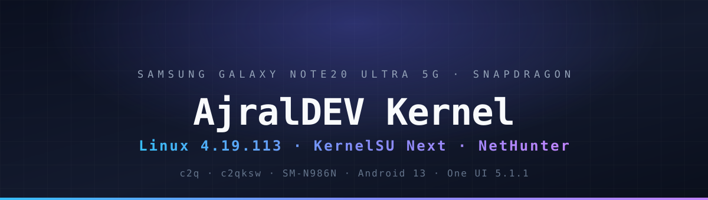

<p align="center">
  
</p>

<p align="center">
  <a href="https://github.com/JackRipper-ID/AjralDEV-Kernel-c2q/releases/latest"></a>
  
  
  
  
</p>

<p align="center">
  <b>One kernel. Root and radio, together.</b><br>
  <sub>KernelSU Next + Magisk hybrid root &nbsp;·&nbsp; MAC80211 monitor mode &nbsp;·&nbsp; nine built-in USB Wi-Fi drivers</sub>
</p>

---

## ⚡ Why this exists

The Galaxy Note20 Ultra Snapdragon is **A-only** — a single boot partition, no slot B. Two kernels cannot coexist, so every capability used to cost you a reflash.

| | KernelSU Next | Wi-Fi monitor | BFQ / WBT | MGLRU |
|:--|:--:|:--:|:--:|:--:|
| `4.19.325` community build | ✅ | ❌ | ⚠️ compiled, CFQ default | ✅ |
| `4.19.113` NetHunter build | ❌ | ✅ | ❌ | ❌ |
| **This build** | ✅ | ✅ | ✅ | ❌ |

> [!NOTE]
> MGLRU is a local backport that exists only in the 4.19.325 tree. It is not part of upstream 4.19.113, so this kernel uses classic LRU. See [Known limitations](#-known-limitations).

---

## 🧩 What's inside

<table>
<tr>
<td width="50%" valign="top">

**Root**
```ini
CONFIG_KSU=y
CONFIG_KPROBES=y      # hook: Kprobes
```
KernelSU Next `v3.4.0-legacy` runs from the kernel driver while Magisk keeps first-stage init. Both are active at once — the ramdisk is reused, never replaced.

</td>
<td width="50%" valign="top">

**Radio**
```ini
CONFIG_MAC80211=y
CONFIG_MAC80211_MESH=y
CONFIG_CFG80211_WEXT=y
CONFIG_NL80211_TESTMODE=y
```
Monitor mode and raw injection on external adapters, with `minstrel_ht` rate control.

</td>
</tr>
<tr>
<td width="50%" valign="top">

**Storage**
```ini
CONFIG_IOSCHED_BFQ=y
CONFIG_BFQ_GROUP_IOSCHED=y
CONFIG_BLK_WBT=y
CONFIG_BLK_WBT_MQ=y
CONFIG_BLK_CGROUP_IOLATENCY=y
```

</td>
<td width="50%" valign="top">

**NetHunter plumbing**
```ini
CONFIG_USB_CONFIGFS_F_HID=y   # BadUSB
CONFIG_HIDRAW=y
CONFIG_IP_NF_TARGET_MASQUERADE=y
CONFIG_NETFILTER_XT_MATCH_STRING=y
CONFIG_NETFILTER_XT_TARGET_NFQUEUE=y
CONFIG_BRIDGE_NF_EBTABLES=y
```

</td>
</tr>
</table>

### 📡 Supported USB adapters

| Driver | Chipsets |
|:--|:--|
| `ath9k_htc` | **AR9271**, AR7010 |
| `carl9170` | AR9170 |
| `rt2800usb` | RT3070, **RT5370**, RT5572, RT33xx, RT35xx, RT3573, RT53xx, RT55xx |
| `mt7601u` | MT7601U |
| `rtl8xxxu` | RTL8188, RTL8192, RTL8723 (CU/AU) |
| `rtl8187` | RTL8187L/B |
| `zd1211rw` | ZD1211, ZD1211B, ZD1215 |
| `p54usb` | Prism54 USB |

All built-in (`=y`). No modules, no signing, no compile step on device.

---

## 📦 Downloads

| Asset | Size | SHA-256 |
|:--|--:|:--|
| [`AjralDEV-Kernel-c2q-4.19.113-KSU-NetHunter-android13.zip`](https://github.com/JackRipper-ID/AjralDEV-Kernel-c2q/releases/latest) | 20,918,653 B | `e1651ce1…71ec9aa` |
| [`Image`](https://github.com/JackRipper-ID/AjralDEV-Kernel-c2q/releases/latest) | 55,439,372 B | `c0adedba…d31c6a0c` |
| [`dtb`](https://github.com/JackRipper-ID/AjralDEV-Kernel-c2q/releases/latest) | 1,580,275 B | `db077314…9fd25a82` |

<details>
<summary><b>Full SHA-256 checksums</b></summary>

```
e1651ce1c664908a5a834103e0183bfc288ebf904499150e4da834e1771ec9aa  AjralDEV-Kernel-c2q-4.19.113-KSU-NetHunter-android13.zip
c0adedba7de461ae95218fe1bb501d069275e9c53ffa5cce33c3a1a3d31c6a0c  Image
db077314559f25032c4ef178a30089067155fd4ded5417aed4dc75d09fd25a82  dtb
```

</details>

---

## 🚀 Flash

```text
1. Boot into TWRP / OrangeFox
2. Install the zip
3. Do not wipe anything
4. Reboot to system
```

> [!IMPORTANT]
> The installer copies the current boot partition to `/sdcard/backup/boot-<YYYYMMDD-HHMMSS>.img` **before** writing anything.

<details>
<summary><b>Verify after boot</b></summary>

```bash
su -c "uname -r"                      # 4.19.113
su -c "magisk -v"                     # 31.1:MAGISK:R
su -c "dmesg | grep -i kernelsu"      # v3.4.0-legacy, hook: kprobes
su -c "zcat /proc/config.gz | grep MAC80211=y"
su -c "iw list | head -20"
```

</details>

<details>
<summary><b>Enable monitor mode</b></summary>

```bash
su -c "ip link set wlan1 down"
su -c "iw dev wlan1 set type monitor"
su -c "ip link set wlan1 up"
su -c "iw dev wlan1 info"
```

Or use the helper:

```bash
sh scripts/monitor-mode.sh wlan1 up
sh scripts/monitor-mode.sh wlan1 down
```

</details>

---

## 🔬 Build integrity

The device tree blob was rebuilt from source and is **byte-for-byte identical** to the blob inside the original 4.19.113 boot image — proof that the source tree matches the shipped kernel.

| DTB entry | Size | SHA-256 prefix | Origin |
|:--|--:|:--|:--|
| 0 | 528,520 B | `b3aeb34a66528acc` | `kona-v2.1.dtb` |
| 1 | 528,516 B | `d68acf630e4473bc` | `kona-v2.dtb` |
| 2 | 523,066 B | `b463d63283610c57` | `kona.dtb` |
| 3 | 173 B | `9becad76b4e58a82` | RTIC `MP_DATA` |

```text
Linux version 4.19.113 (ajraldev@Killer)
clang version 10.0.6 for Android NDK
#1 SMP PREEMPT Fri Nov 20 20:49:25 WIB 2026
```

---

## ⚠️ Known limitations

| Limitation | Detail |
|:--|:--|
| **No MGLRU** | `CONFIG_LRU_GEN` does not exist in the 4.19.113 tree |
| **No external modules** | `MODULE_SIG_FORCE=y` + `MODVERSIONS=y` — drivers must be built-in |
| **No RTL8812AU / RTW88** | Not part of upstream 4.19, not backported |
| **No on-board monitor** | BCM4375 (`bcmdhd`) is STA-only; USB adapters only |
| **No TC/IFB** | Not enabled in the Samsung base config; plain `iptables` NAT works |

---

## 🛠 Reproducing the build

Source: [`postkevone/c2q-kernelsu-next`](https://github.com/postkevone/c2q-kernelsu-next) (`N986NKSSAHYH1`) · KernelSU Next `legacy` · AOSP clang 10.0.6

Three host-environment fixes are required on modern distros:

| Symptom | Cause | Fix |
|:--|:--|:--|
| `prerequisites cannot be defined in recipes` | GNU Make 4.4 vs Samsung `techpack` | build with **GNU Make 4.3** |
| `undefined reference to ENGINE_*` | OpenSSL 4.x removed the ENGINE API | `#define OPENSSL_ENGINE_STUBS 1` in `scripts/sign-file.c` + `scripts/extract-cert.c` |
| `implicit declaration of strscpy_pad` | KernelSU Next guard uses `4.14.222`; the symbol landed in 4.20 | patch `drivers/kernelsu/compat/kernel_compat.h` guard to `4.20.0` |

<details>
<summary><b>Repository layout</b></summary>

```text
.
├── assets/banner.svg
├── kernel/c2q_kor_singlew_defconfig     # resolved config
├── patches/
│   ├── 0001-kernelsu-next-and-build-fixes.patch
│   └── 0002-defconfig-nethunter.patch
├── scripts/
│   ├── anykernel.sh
│   ├── build.sh
│   └── monitor-mode.sh
├── LICENSE
├── SHA256SUMS
└── README.md
```

</details>

<details>
<summary><b>Build commands</b></summary>

```bash
# 1. source + toolchain
git clone --depth 1 -b main https://github.com/postkevone/c2q-kernelsu-next.git c2q
git clone --depth 1 -b toolchain https://github.com/postkevone/sm8250-toolchain.git c2q/toolchain

# 2. KernelSU Next (legacy) + core patches
cd c2q
curl -LSs https://raw.githubusercontent.com/KernelSU-Next/KernelSU-Next/next/kernel/setup.sh | bash -s legacy
cp -rf kernelsu-patches/. .
cp -f kernelsu-defconfig/c2q_kor_singlew_defconfig arch/arm64/configs/vendor/

# 3. apply host fixes
patch -p1 < ../patches/0001-kernelsu-next-and-build-fixes.patch

# 4. build (GNU Make 4.3 required)
ARCH=arm64 CROSS_COMPILE=$PWD/toolchain/gcc/linux-x86/aarch64/aarch64-linux-android-4.9/bin/aarch64-linux-android- \
REAL_CC=$PWD/toolchain/llvm-arm-toolchain-ship/10.0/bin/clang CLANG_TRIPLE=aarch64-linux-gnu- \
make -j$(nproc) O=out DTC_EXT=$PWD/tools/dtc CONFIG_BUILD_ARM64_DT_OVERLAY=y \
  vendor/c2q_kor_singlew_defconfig Image
```

</details>

---

## ↩️ Rollback

Three independent paths back:

1. `/sdcard/backup/boot-<date>.img` — written automatically by the installer
2. The previous `4.19.325` boot image — `15646f4f…6c6a4a1f`
3. Re-flash the previous AnyKernel zip for 4.19.325

---

## 📄 License

Kernel sources are **GPL-2.0**. See [LICENSE](LICENSE). Any redistribution of the binary must
comply with the GPL — the defconfig, patches, and build scripts used here are published in this
repository.

KernelSU Next is GPL-2.0. Samsung components remain the property of their respective owners.
This is an unofficial community build, not affiliated with or endorsed by Samsung.

<p align="center">
  <sub>Built by <a href="https://github.com/JackRipper-ID">JackRipper-ID</a> · AjralDEV</sub>
</p>
